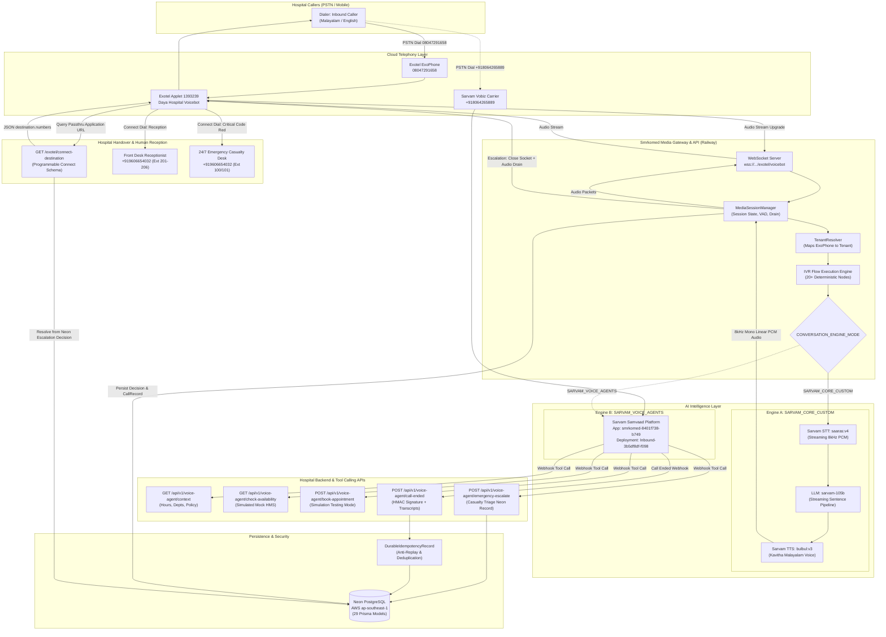

# SMRKOMED — TECHNICAL ARCHITECTURE SPECIFICATION

## 1. System Technology Stack

| Layer | Technology | Version | Purpose |
|---|---|---|---|
| **Frontend Framework** | Next.js (App Router) | `16.0.7` | UI shell, dashboard, IVR flow builder, agent configuration, settings |
| **UI Library & Components** | React / Tailwind CSS / Radix UI | `React 19.2.0`, `Tailwind 4` | Responsive hospital admin UI, accessible components |
| **Icons & Visualizations** | Lucide React / Recharts | `lucide-react 1.16.0`, `recharts 2.15.1` | Dashboard metrics, KPI charts, call volume analytics |
| **Backend API Layer** | Next.js App Router Route Handlers | Node.js `22.x` runtime | 62 REST API endpoints handling auth, config, IVR, webhooks, voice tools |
| **Telephony Media Gateway** | Standalone Node.js WebSocket Server | `ws 8.18.0`, `tsx 4.19.2` | Low-latency binary PCM audio streaming server on port `8080` (or `PORT`) |
| **Programming Language** | TypeScript | `5.7.2` | Strict type safety across frontend, backend, gateway, and test suites |
| **Database & ORM** | PostgreSQL / Prisma ORM | `Prisma 6.0.0` / `@prisma/client 6.0.0` | Relational multi-tenant schema with 29 models, compound indexes, migrations |
| **Database Hosting** | Neon Serverless PostgreSQL | AWS `ap-southeast-1` (Singapore) | Auto-scaling managed PostgreSQL with pooled and direct connection strings |
| **Cloud Hosting** | Railway PaaS | Linux container / Nixpacks | Unified production hosting (`Daya_hospital` in project `ravi-rebirth`) |
| **AI Speech & NLU Engine** | Sarvam AI Platform | Saaras:v4, 105b, Bulbul:v3, Samvaad | Dual engine: Custom streaming pipeline or Sarvam Voice Agents |
| **Telephony Provider** | Exotel Cloud Telephony | Singapore Cluster (`api.exotel.com`) | Inbound virtual numbers, Passthru routing, Programmable Connect |

---

## 2. End-to-End System Architecture Diagram

The diagram below reflects the **actual current production architecture** of Smrkomed, showing the dual conversational engine path, the Exotel carrier connection, and the human receptionist handover.



---

## 3. Detailed Component Architecture

### 3.1 Frontend Architecture
- **Framework:** Next.js 16.0.7 App Router with React 19.2.0.
- **Routing Structure:**
  - `/` (Home redirect to overview or login)
  - `/login` (Authentication with hospital branding)
  - `/overview` (Executive KPI dashboard, call volume trends, action breakdowns)
  - `/calls` (Searchable call log table, filters by status/intent/action/date)
  - `/calls/[callId]` (Detailed call drilldown: turn-by-turn transcript, audio player, audit log)
  - `/actions` (Clinical follow-up tasks, appointment actions review)
  - `/ivr` (Hospital IVR flow catalog, version list, emergency overrides)
  - `/ivr/[flowId]` (Visual IVR drag-and-drop node canvas, validator, simulation tester)
  - `/agents` (AI voice agent roster, status pills)
  - `/agents/[agentId]` (Agent prompt editor, voice model selector, guardrails, audio test sandbox)
  - `/knowledge-base` (Knowledge base CMS for OPD timings, departments, hospital FAQs)
  - `/settings` (Hospital general settings, telephony config, voice agent mode, routing numbers, staff management)
- **State Management:** React local state (`useState`, `useReducer`), custom hooks, URL query parameter synchronization (`useSearchParams`), and toast notifications (`useToast`).

### 3.2 Backend API Architecture
- **Framework:** Next.js App Router Route Handlers (`src/app/api/**/*`).
- **Endpoint Volume:** 62 route handlers organized into distinct namespaces:
  - `/api/auth/*` (Login, logout, session verification, password changes)
  - `/api/calls/*` (Call list retrieval, detail inspection, audio streaming proxy, outbound calling)
  - `/api/v1/ivr/*` (Flow CRUD, validation, publishing, simulation, emergency routing)
  - `/api/v1/agents/*` (Agent configuration, prompt editing, version control, voice preview synthesis)
  - `/api/v1/config/*` (Hospital configuration drafts, validation, publishing, routing destination management)
  - `/api/v1/voice-agent/*` (Sarvam Voice Agent tool-calling webhooks: context, availability, booking, escalation, call-ended)
  - `/api/webhooks/*` (Carrier status callbacks from Exotel and Sarvam)
  - `/api/knowledge/*` (Knowledge article authoring and publishing)

### 3.3 Media Gateway Server
- **Implementation:** Standalone Node.js server (`src/media-gateway/server.ts`) built with Node's native `http` module and the `ws` WebSocket library.
- **Protocols:**
  - **HTTP Endpoints:**
    - `GET /health` and `GET /healthz`: Health probe returning 200 OK with gateway metrics.
    - `GET /status`: Extended system telemetry, active call counts, Sarvam connection state.
    - `GET /exotel/connect-destination`: Exotel Programmable Connect Application URL endpoint.
    - `POST /exotel/passthru`: Exotel Passthru callback endpoint.
  - **WebSocket Endpoints:**
    - `WSS /exotel/voicebot`: Real-time audio streaming connection for Exotel AgentStream.
- **Audio Processing Engine:**
  - Converts incoming audio chunks from base64/JSON frames into raw linear PCM buffers.
  - Maintains a sliding audio buffer for local energy-based Voice Activity Detection (VAD).
  - Handles barge-in by interrupting TTS playback when incoming caller voice energy exceeds threshold.
  - Supports audio drain flushing on call transfer to ensure goodbye messages finish playing before carrier handoff.

### 3.4 Database Architecture
- **Database Engine:** PostgreSQL 16 on Neon Serverless (`ap-southeast-1`).
- **Data Access:** Prisma Client (`prisma 6.0.0`) with global singleton pooling.
- **Models:** 29 normalized relational models partitioned by `hospitalId`.
- **Durable Concurrency & Deduplication:**
  - `DurableIdempotencyRecord`: Prevents duplicate webhook execution and double-booking.
  - `DurableRateLimitBucket`: Implements token-bucket rate limiting for outbound calling.

### 3.5 Telephony & Escalation Architecture
- **Carrier:** Exotel Cloud Telephony (Singapore account `smrkomed1`).
- **Carrier Applet:** Applet `1393239` handles inbound PSTN routing and streams audio to Railway.
- **Escalation Protocol:**
  When a caller requests a human receptionist or triggers emergency casualty triage:
  1. The Media Gateway writes an escalation record to Neon DB via `MediaSessionManager.recordEscalationDecision()`.
  2. The Media Gateway flushes remaining goodbye audio and cleanly closes the WebSocket.
  3. Exotel falls through to its Passthru/Connect Applet and queries `GET /exotel/connect-destination?CallSid=...`.
  4. Smrkomed looks up the durable escalation decision from Neon DB.
  5. Smrkomed responds with the official Exotel Programmable Connect JSON payload:
     ```json
     {
       "fetch_after_attempt": false,
       "destination": {
         "numbers": ["+919606654032"]
       },
       "record": true
     }
     ```
  6. Exotel immediately bridges the live caller to the hospital destination number.

---

## 4. Environment & Deployment Topology

- **Source Control:** GitHub repository on branch `main`.
- **Hosting Platform:** Railway service `Daya_hospital` in project `ravi-rebirth`.
- **Containerization:** Nixpacks / Node.js container executing `npm run build` and `npm start`.
- **Media Gateway Port Binding:** Single-port architecture: the media gateway and Next.js handlers run within the Railway container, binding to `0.0.0.0:$PORT`.
- **Networking:** HTTPS and WSS traffic terminated by Railway edge proxy with TLS 1.3.
