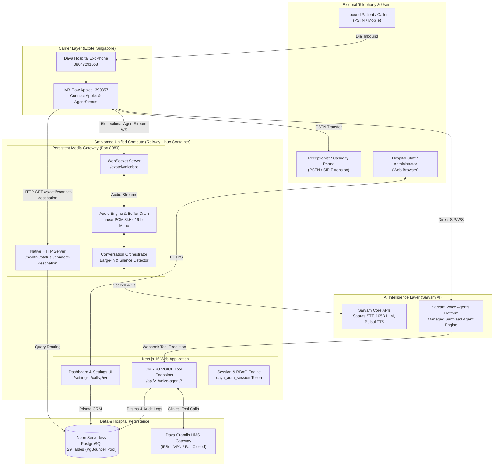
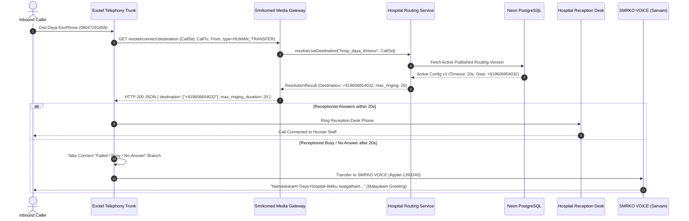
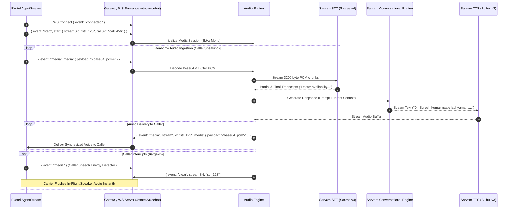
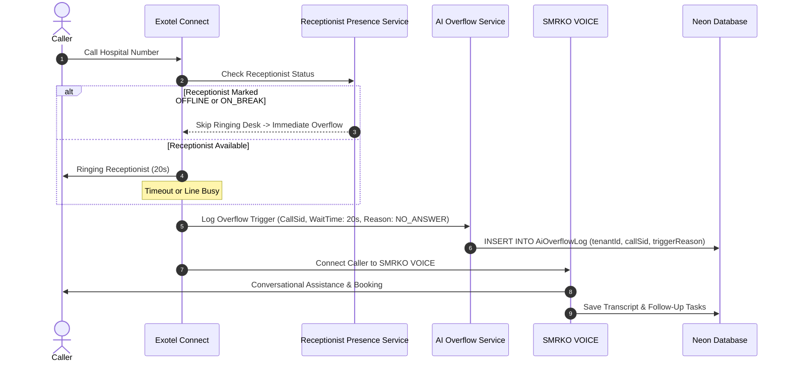
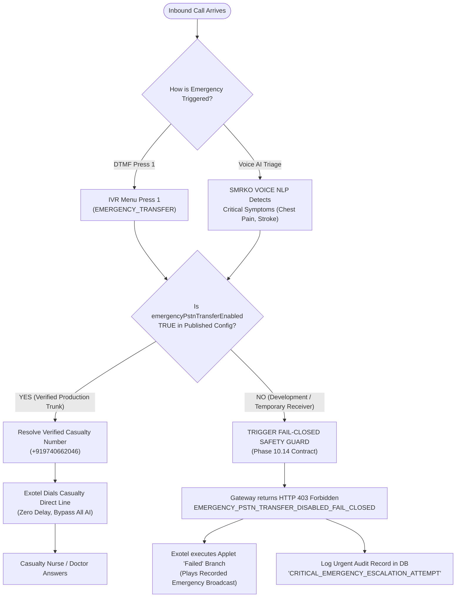
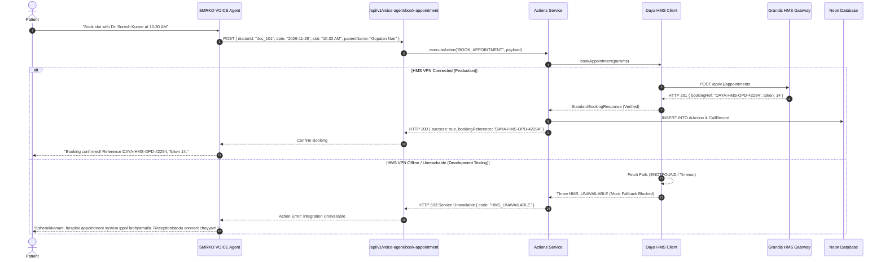
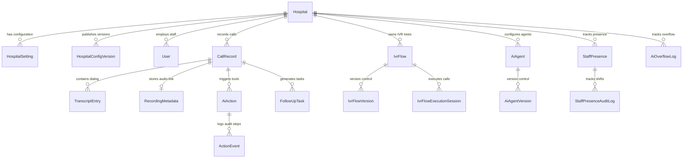
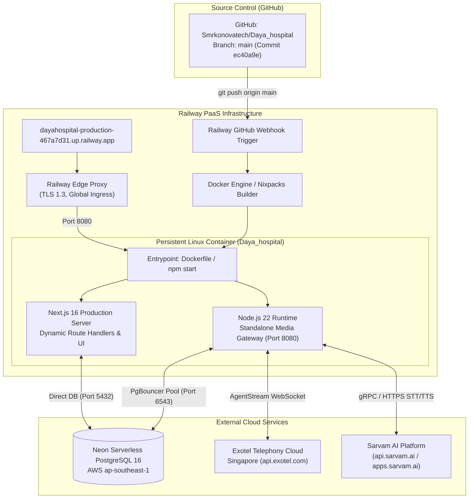

# 03 — Complete System Architecture & Workflows

This document details the software architecture, runtime orchestration, communication protocols, and control flows of **Smrkomed / SMRKO VOICE**, supported by 8 source-code-verified Mermaid diagrams.

---

## 1. Overall System Architecture

The platform consists of five interconnected subsystems:
1. **Cloud Telephony Carrier (Exotel):** Ingests PSTN phone calls on virtual hospital DIDs (ExoPhones), runs IVR logic, and bridges audio streams.
2. **Real-Time Persistent Media Gateway:** Persistent Node.js container handling bidirectional WebSocket audio (`/exotel/voicebot`), low-latency connect queries (`/exotel/connect-destination`), and speech pipeline coordination.
3. **Application & Management Portal (Next.js 16):** Serves the hospital management dashboard, clinical review player, configuration versioning, and secure RESTful tool endpoints.
4. **AI Speech & Dialogue Intelligence (Sarvam AI):** Multilingual Indian AI providing STT, conversational LLM reasoning, and TTS synthesis.
5. **Hospital Systems & Storage:** Neon Serverless PostgreSQL and Daya Hospital's Grandis HMS gateway.

---

## 2. Inbound Call Lifecycle

Every inbound phone call follows an authoritative lifecycle managed through Exotel webhooks, Smrkomed routing adapters, and media sessions.

---

## 3. Exotel-to-SMRKO VOICE Integration (AgentStream vs Managed Agent)

Smrkomed implements two distinct AI voice mechanisms:
- **Architecture A (Persistent WebSocket Media Gateway):** Raw linear PCM audio chunks (320 bytes / 20ms) stream over WebSocket to [src/media-gateway/server.ts](file:///c:/Users/mohit/Downloads/daya/Daya_hospital/src/media-gateway/server.ts).
- **Architecture B (Managed Voice Agent):** Exotel routes directly to Sarvam Voice Agents (`apps.sarvam.ai`), which invokes Smrkomed REST webhooks.

---

## 4. Human Receptionist Fallback & Overflow Management

When human staff are occupied, calls automatically overflow to AI without dropping. Every overflow event is logged with full clinical context.

---

## 5. Emergency Escalation Workflow & Safety Guards

Emergency safety operates under strict clinical fail-closed rules.

---

## 6. Real-Time Appointment Booking Workflow (Grandis HMS)

Clinical tool execution enforces server-side validation and fail-closed handling when real HMS connectivity is unavailable.

---

## 7. Database & Multi-Tenant Relationship Overview

The schema is partitioned across multi-tenant configuration, telephony sessions, clinical knowledge, and staff presence.

---

## 8. Deployment & Hosting Architecture

The system runs on Railway persistent compute with automated Docker/Nixpacks builds from GitHub.

