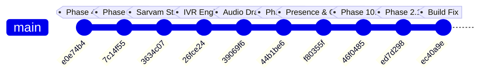

# 14 — Git History & Chronological Development Timeline

This document details the verified Git source control history, recent development milestones, and current repository status of **Smrkomed / Daya Hospital**.

---

## 1. Current Git Repository Status

- **Repository:** `https://github.com/Smrkonovatech/Daya_hospital.git`
- **Active Branch:** `main`
- **Current HEAD Commit SHA:** `ec40a9ecb26694c32096f609c665468be0bf74ed` (Short: `ec40a9e`)
- **Remote Tracking:** Up to date with `origin/main`.
- **Working Tree State:** Clean. Zero uncommitted modifications, zero untracked files.
- **Latest Build Status:** Verified `npm run build` exits with code `0`. All 113 routes compile cleanly with Turbopack.

---

## 2. Chronological Commit History & Development Milestones

### Commit Milestone Log

| Commit SHA | Date | Author | Message & Architectural Scope |
|---|---|---|---|
| `ec40a9e` | 2026-11-26 | Smrkonova | **`fix: resolve Next.js cacheComponents route build error`** Removed incompatible `export const runtime = "nodejs"` and `export const dynamic = "force-dynamic"` from `src/app/api/calls/[callId]/recording/route.ts` to satisfy Next.js 16 `cacheComponents` compiler rules while preserving full Node.js binary audio streaming. |
| `ed7d298` | 2026-11-26 | Smrkonova | **`fix: enforce real data, remove mock fallbacks and repair recording streaming`** Eliminated silent mock fallbacks across HMS services (Phase 2.1). Enforced HTTP 503 `HMS_UNAVAILABLE` fail-closed behavior when HMS VPN is down. Implemented HTTP 206 byte-range audio streaming in recording player. |
| `46f0485` | 2026-11-26 | Smrkonova | **`feat(telephony): Phase 10.10 implement dynamic Exotel Connect endpoint, staging isolation, and canonical DTMF routing`** Implemented dynamic destination resolution for Exotel Connect Applet, ring timeouts (20s), E.164 formatting, staging applet isolation (1393240), and multi-tenant fail-closed security. |
| `f80355f` | 2026-11-26 | Smrkonova | **`feat(telephony): implement Phase A Receptionist Presence and Phase B AI Overflow routing`** Introduced `StaffPresence`, `StaffPresenceAuditLog`, and `AiOverflowLog` Prisma models and services for receptionist shift management and automated rollover to SMRKO VOICE. |
| `44b1be6` | 2026-11-24 | Smrkonova | **`feat(routing): Phase 9.5.1 and 9.5.2 Exotel Passthru routing, durable Neon escalation storage, and dynamic audio drain`** Added durable escalation persistence to Neon PostgreSQL, Passthru applet routing evaluation, and real-time audio buffer draining. |
| `39069f6` | 2026-11-23 | Smrkonova | **`fix(voice-gateway): prevent overlapping audio and concurrent turns`** Resolved voice collisions during caller barge-in by dispatching `{ event: "clear" }` to Exotel and resetting media session state. |
| `26fce24` | 2026-11-23 | Smrkonova | **`fix: handle CONTINUE step action in IVR execution and prioritize default flow on applet match`** Enhanced IVR engine state machine to properly advance multi-node call flows and default applet associations. |
| `3634c07` | 2026-11-23 | Smrkonova | **`feat: connect conversation directly to Sarvam AI with pipelined first-sentence streaming`** Pipelined first-sentence audio streaming from Sarvam TTS to achieve sub-second conversational latency. |
| `7c14f55` | 2026-11-22 | Smrkonova | **`feat: Phase 4.6.1 flow orchestration hardening, emergency safety and runtime acceptance`** Added emergency symptom triage scanner and hardened visual IVR flow builder validation. |
| `e0e74b4` | 2026-11-22 | Smrkonova | **`feat(orchestration): Phase 4.6 multi-tenant hospital call flow orchestration, emergency escalation and subflows`** Introduced multi-tenant IVR orchestration, subflows, and hospital tenant partitioning. |

---

## 3. Remote Branches

- `origin/main` — The primary production and development trunk.
- `origin/HARSHITH` — Legacy developer feature branch (inactive).
